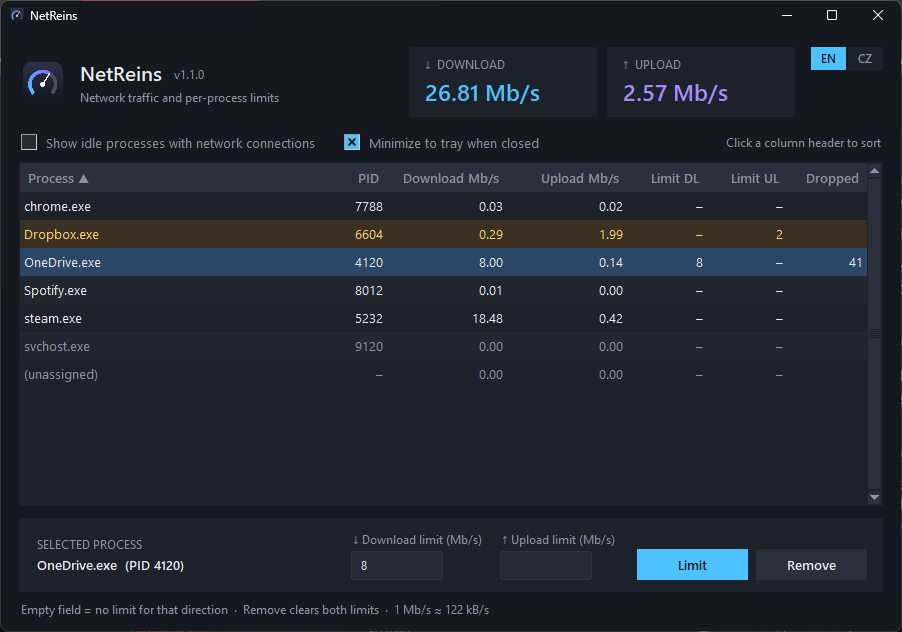

# NetReins

**Per-process network monitor and bandwidth limiter for Windows.**

[Čeština](README.cs.md)



NetReins shows which programs are using your network right now and lets you cap
the download and/or upload speed of any of them – for example keep OneDrive or a
game updater from eating the whole connection.

- live table of processes with download/upload speed in **Mb/s** (refreshed every second)
- download and/or upload limit per process, applied instantly, removed instantly
- tray icon – keeps limiting in the background, right-click menu to open, remove all limits or quit
- dark UI, English and Czech (remembered between runs)
- single portable `.exe`, nothing to install

## Download

Get `NetReins.exe` from the [latest release](../../releases/latest) and run it.
Windows will ask for administrator rights – NetReins needs them to load the
[WinDivert](https://reqrypt.org/windivert.html) network driver that does the
limiting.

**Requirements:** Windows 10 or 11, 64-bit.

> **Windows warning on first start?** New releases are not yet known to
> Microsoft SmartScreen. Click **More info → Run anyway**. Some antivirus
> programs also flag WinDivert as a "HackTool", because the same driver is used by
> other network tools. Every release is built from this repository by
> [GitHub Actions](../../actions) and its SHA-256 checksum is published with it.

## How to use

1. Start something that uses the network. The process appears in the table.
2. Click its row, enter **Download limit** and/or **Upload limit** in Mb/s and press **Limit**.
   An empty field means "no limit in this direction". Decimals work (`0.5` or `0,5`).
3. **Remove** clears both limits of the selected process.

Click a column header to sort (default: process name A→Z).
Limited processes are highlighted, the **Dropped** column counts packets
dropped because the queue was full.

**Closing the window** hides NetReins to the tray and the limits stay active
(untick *Minimize to tray when closed* to quit instead). To exit, right-click the
tray icon → **Quit**. Limits only exist while NetReins runs – after it exits,
all traffic flows normally again, even if it crashes.

Running NetReins a second time just brings the existing window to the front.

**About** in the tray icon menu shows the version, license, a link to this
repository and the third-party components.

**Units:** 1 Mb/s = 1,000,000 bits per second ≈ 122 kB/s, the same unit Windows
Task Manager uses.

**Browsers** (Chrome, Edge, Vivaldi, Firefox) run many processes, but network
traffic usually goes through just one of them. Limit the one that shows traffic
while downloading.

## How it works

NetReins diverts all TCP and UDP packets (except loopback) through
[WinDivert](https://reqrypt.org/windivert.html). Each packet is matched to a
process by its local port (`psutil.net_connections()`, cached and refreshed
every ~2 s). Packets of limited processes go through a token bucket per process
and direction; packets over the limit wait in a short queue (about 1 s of
traffic) and are dropped when the queue is full, so TCP slows down by itself.
Speeds are measured from the packets NetReins actually re-injects, so the
numbers already reflect the limit and nothing is counted twice.

| file | purpose |
|---|---|
| `capture.py` | WinDivert handle, capture thread, scheduler, token buckets and queues |
| `monitor.py` | port → PID cache, traffic counters |
| `gui.py` | tkinter window |
| `tray.py` | tray icon and menu (pystray) |
| `main.py` | startup, admin check, clean shutdown |
| `winutil.py` | bringing the window to the front, single instance |
| `i18n.py`, `settings.py` | translations, saved settings (`%APPDATA%\NetReins\settings.json`) |
| `theme.py`, `make_icon.py` | dark theme, icon generator |

## Running from source

```bash
pip install -r requirements.txt
```

Then run `python main.py` from a terminal opened with **Run as administrator**.

Tests (no driver or admin rights needed):

```bash
pip install -r requirements-dev.txt
```

```bash
python -m pytest
```

Build the single-file exe (`dist\NetReins.exe`):

```bash
build_exe.bat
```

Pushing a tag `vX.Y.Z` builds the exe on GitHub Actions and publishes a release.

## Known limitations

- All TCP/UDP traffic passes through Python; at hundreds of Mb/s CPU usage
  grows and total throughput may drop.
- A brand-new connection can briefly show as *(unassigned)* before the port
  cache catches up.
- Port-based matching does not distinguish IPv4 and IPv6 sockets on the same port.

## License

NetReins is released under the [MIT License](LICENSE).
It bundles third-party components under their own licenses – see
[THIRD_PARTY_NOTICES.md](THIRD_PARTY_NOTICES.md).
